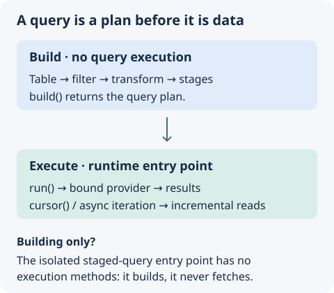

AQL has several query classes that form a hierarchy of capabilities. Each class covers one level of a database interaction, from a whole table down to one value inside a query.

## Choose by the result you need

| You are working with…           | Type                 | Typical next operation                                          |
| ------------------------------- | -------------------- | --------------------------------------------------------------- |
| A whole table                   | `Table<T>`           | Insert a record or select by key.                               |
| Several writable records        | `Selection<T>`       | Update or delete the selection.                                 |
| One writable record             | `SingleSelection<T>` | Read, update, or delete by key.                                 |
| A sequence of query results     | `Stream<T>`          | Map, sort, aggregate, or paginate.                              |
| One query result                | `Datum<T>`           | Read a field or transform the value.                            |
| A value inside a query callback | `ValueProxy<T>`      | Build an expression with `eq`, `add`, or other query operators. |

`ValueProxy` describes a database expression. It is not the fetched JavaScript value. Use its operators inside query callbacks, then execute the outer query to get data.

{width="480"}

## Query type hierarchy

Every query type inherits from `StagedObject`, which records operations as a pipeline of stages. The hierarchy is:

```
Query<T>
├── Datum<T>
│   └── SingleSelection<T>
└── Stream<T>
    └── Selection<T>
        └── Table<T>

ValueProxy<T> (used within query callbacks)
```

## Common features

Every query type that extends `Query<T>` has these methods:

- `run()` executes the query and returns a `Promise<T>` with the result.
- `then()` makes the query `PromiseLike`, so you can await it directly.
- `cursor()` returns an `AsyncGenerator` that yields results one at a time.
- `[Symbol.asyncIterator]()` enables `for await...of` loops over the query results.

```typescript fragment
import { Schema } from "@antelopejs/interface-database";

// Execute a query explicitly
const result = await schema.instance().table("users").run();

// Await the query directly (uses PromiseLike)
const users = await schema.instance().table("users");

// Iterate with async generator
for await (const user of schema.instance().table("users")) {
  console.log(user.name);
}
```

## Recognize a query type

`IsQuery`, `IsDatum`, `IsStream` and `IsValueProxy` tell what kind of staged object a value is:

```typescript
import { IsStream } from "@antelopejs/interface-database";

function describe(query: unknown) {
  return IsStream(query) ? "a sequence of documents" : "a single value";
}
```

Each provider binding of the interface has its own copy of these classes. A query that a module bound to another database built is therefore not an `instanceof` this module's `Stream`. The predicates recognize a query whichever copy built it. Use `instanceof` only to check that a query was built for this module's own binding.

## Available query types

- [Table](./2.table.md) is a database table with `insert`, `get`, `getAll`, `between`, and `atomicMutation`.
- [Selection](./3.selection.md) is a set of documents that supports `update`, `replace`, and `delete`.
- [SingleSelection](./4.single_selection.md) is one document with `update`, `replace`, `delete`, and change feed support.
- [Stream](./5.stream.md) is a sequence of results with `map`, `filter`, `join`, `group`, aggregation, and sort operations.
- [Change feeds](./6.feed.md) are real-time change notifications from the `changes()` method.
- [Query](./7.query.md) is the base class that provides execution and async iteration.
- [Datum](./8.datum.md) is a single value with field access, transformation, and lookup.
- [ValueProxy](./9.valueproxy.md) is a proxy for in-query operations on numbers, strings, dates, arrays, and objects.
